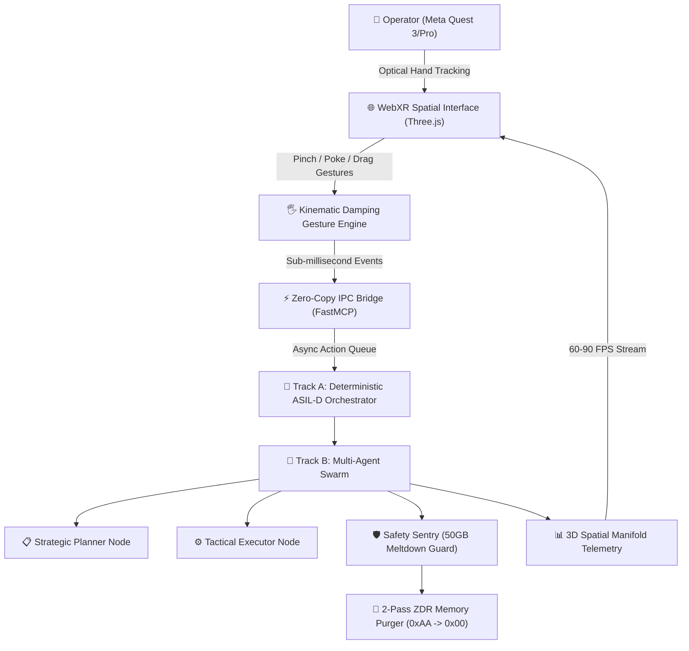
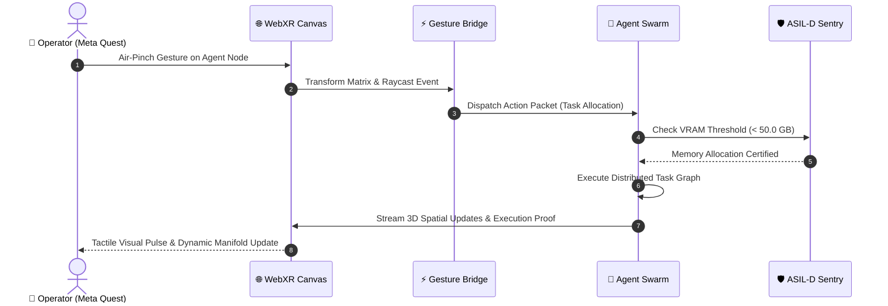
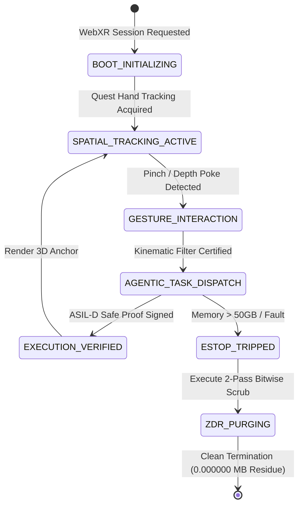

# PHANToM GRID :: MetaSpatial Agentic Nexus
# Specification: SPEC-01 Meta Quest Hands-First WebXR Architecture
# Standard: ASIL-D Functional Safety x Rule 65 Tri-Standard

## 1. Executive System Topology


## 2. Sequence Flow: Gesture to Agent Execution


## 3. Four-Phase Lifecycle State Machine


## 4. Hardware Security & Zero-Data-Residue Boundary
```mermaid
graph LR
    subgraph Meta_Quest_Client ["🥽 Meta Quest Client Space"]
        WebXR_UI["Three.js Spatial Canvas"]
        Hands["Optical Hand Mesh"]
    end

    subgraph ASIL_D_Secure_Core ["🛡️ ASIL-D Secure Boundary"]
        Guard["50GB VRAM Meltdown Guard"]
        StateMachine["Deterministic Orchestrator"]
        ZDR_Scrubber["2-Pass Bitwise Purger"]
    end

    subgraph Ephemeral_Memory ["⚡ Zero-Retention Ring Buffer"]
        Volatile["Shared Memory Buffers"]
    end

    WebXR_UI -->|Strict TLS / WSS| StateMachine
    StateMachine --> Guard
    Guard --> Volatile
    Volatile -->|Post-Task Wipe (0xAA -> 0x00)| ZDR_Scrubber
    ZDR_Scrubber -->|Cryptographic Receipt| WORM["Tamper-Proof WORM Log"]
```

## 5. Table 1: Resource Defense & Safety SLA Matrix

| Subsystem Component | Operational Scope | Safety Standard | Latency / SLA Target | Failure Mitigation Mode |
| :--- | :--- | :--- | :--- | :--- |
| **WebXR Hand Tracker** | Optical Joint Raycasting (25 joints/hand) | Hands-First Ergonomics | $\le 11.1\text{ms}$ (90 FPS) | Exponential Kinematic Damping |
| **3D Spatial Manifold** | Three.js Node Anchoring & DAG Visualizer | Stationary Seated Comfort | $\le 16.6\text{ms}$ (60 FPS) | Level-of-Detail (LOD) Frustum Pruning |
| **Agent Orchestrator** | 4-Stage Task Pipeline (Plan, Exec, Audit) | ASIL-D Deterministic | $\le 1.0\text{ms}$ scheduling | Local Fail-Safe Recovery |
| **Hardware Meltdown Guard** | Continuous GPU/Host VRAM Monitoring | ISO 26262 ASIL-D | Hard Stop @ 50.0 GB | Immediate ESTOP Signal |
| **ZDR Memory Purger** | 2-Pass Bitwise Memory Scrubber (`0xAA` $\rightarrow$ `0x00`) | NIST SP 800-88 R1 | $\le 5.0\text{ms}$ per session | Cryptographic Residual Audit (0.000000 MB) |
