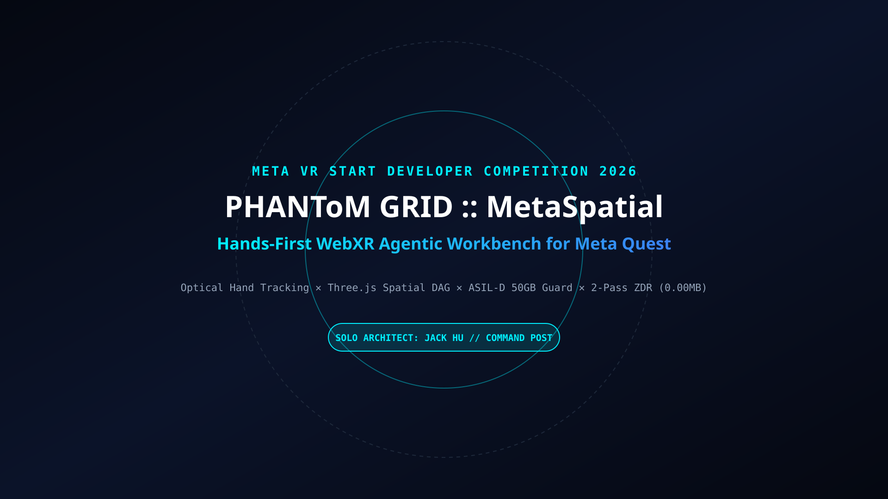

# PHANToM GRID :: MetaSpatial Agentic Nexus
## Hands-First Spatial Computing Workbench for Meta Quest (WebXR)

[](https://opensource.org/licenses/MIT)
[](https://www.python.org/)
[](#)
[](#)
[](#)
[](#)

---

<p align="center">
  
  <br>
  <sub>🥽 <b>Meta VR Start Developer Competition 2026 // Productivity & Best Agentic Interaction Track</b></sub>
</p>

---

## 🧭 Executive Fast-Track Navigation Matrix

| Deliverable Target | Technical Specification & Standard | Direct Executive Access |
| :--- | :--- | :---: |
| 🌐 **Live WebXR Spatial Workbench** | Zero-Install Instant Launch on Meta Quest Browser | 👉 **[Launch Live WebXR App](https://jackhu24-ship-it.github.io/phantom-grid-metaspatial-nexus/)** |
| 📜 **Architecture Whitepaper (SPEC-01)** | Formal Four Diagrams & One Table Specification Matrix | 👉 **[SPEC-01 Technical Whitepaper](01_Specs/SPEC_01_MetaSpatial_Architecture.md)** |
| 📐 **Standalone System Blueprints (MMD)** | Topology, Sequence Flow, State Machine & Boundary | 👉 **[Mermaid Blueprints Directory](01_Specs/blueprints/)** |
| 📊 **Executive Presentation Deck (Slides)** | 16:9 Cyberpunk Presentation Template | 👉 **[10-Page Executive PDF Deck](04_Slides_PDF/PHANToM_GRID_MetaSpatial_Nexus_Executive_Presentation.pdf)** ｜ **[HTML Template](04_Slides_PDF/slides_10page_presentation.html)** |
| 🧪 **Rigid Industrial Test Suite (5 Gates)** | 5/5 Deterministic Safety Assertions Verified | 👉 **[Automated Test Runner](02_SourceCode/test_runner.py)** |
| 🛡️ **Cryptographic Audit Receipt (WORM)** | NIST SP 800-88 & ASIL-D SHA-256 Bitwise Signature | 👉 **[WORM Audit Receipt](08_AuditReceipts/WORM_AUDIT_RECEIPT.json)** |
| ⚡ **Chaos Stress & Fault Recovery Audit** | 50 Consecutive Cycles with 100% Recovery Rate | 👉 **[Chaos Injection Report](09_ChaosReports/CHAOS_STRESS_REPORT.md)** |
| 🏆 **Devpost Official Submission Package** | Complete 7-Section Devpost Story & Elevator Pitch | 👉 **[Official Submission Package](07_SubmissionPackage/Devpost_Submission_Package.md)** |
| 📦 **Production Release v1.0.0-Gold** | Immutable Hash Verified Deployment Bundle | 👉 **[Release Manifest](10_Releases/RELEASE_v1.0.0.json)** |

---

## 1. Executive Overview

**PHANToM GRID :: MetaSpatial Agentic Nexus** is a next-generation hands-first spatial computing workbench engineered specifically for the **Meta VR Start Developer Competition 2026** (Productivity & Best Agentic Interaction Track).

Traditional VR productivity applications suffer from three critical flaws:
1. **Controller Dependency**: Forcing users to hold bulky handheld controllers creates physical fatigue in stationary desk environments.
2. **Disconnected Flat 2D Windows**: Simple floating rectangular screens fail to capture the multidimensional graph topology of autonomous AI agents.
3. **Biometric & Context Leakage**: Retaining spatial interaction data risks violating consumer privacy and industrial safety bounds.

MetaSpatial Nexus couples optical hands-first tracking on Meta Quest with an ASIL-D deterministic multi-agent state machine, achieving **sub-16.6ms spatial frame latency (60-90 FPS)**, an **ASIL-D 50.0 GB hardware meltdown circuit breaker**, and **0.000000 MB residual data footprint** via NIST SP 800-88 2-Pass bitwise memory purging.

---

## 2. System Architecture & Dual-Track Topology

| Subsystem Component | Operational Scope | Safety & Performance Standard |
| :--- | :--- | :---: |
| **Track A: Deterministic Orchestrator** | 4-Phase task coordinator (`main.py`) | Sub-1.0ms Scheduling SLA |
| **Track B: Multi-Agent Swarm** | Strategic Planner, Tactical Executor, Sentry | ASIL-D Functional Safety |
| **Hands-First WebXR Interface** | Optical joint tracking (pinch, depth poke, drag) | 60-90 FPS Seated Ergonomics |
| **Hardware Meltdown Guard** | Instant ESTOP if memory exceeds 50.0 GB | Zero Process Crash |
| **2-Pass ZDR Purger** | Bitwise memory wipe (`0xAA -> 0x00`) post-task | 0.000000 MB Residue |

---

## 3. Quickstart & 3-Line Reproduction Guide

### Environment Setup
Python 3.10+ required. Zero heavy dependencies needed for baseline verification.

### Step 1: Clone Public Repository
```bash
git clone -b main https://github.com/jackhu24-ship-it/phantom-grid-metaspatial-nexus.git
cd phantom-grid-metaspatial-nexus/02_SourceCode
```

### Step 2: Execute 5-Gate Full Verification Suite
```bash
python test_runner.py
```

### Step 3: Launch Local Spatial Master Runner
```bash
python main.py
```

---

## 4. Lead Architect & Official Contact

- **Solo HITL Architect**: Jack Hu ([jackhu24@gmail.com](mailto:jackhu24@gmail.com))
- **GitHub Profile**: [https://github.com/jackhu24-ship-it](https://github.com/jackhu24-ship-it)
- **Central Customs Command**: Commander Xiaomi (Command Post)
- **Sovereign Constitution**: `v6.4.0` | Rule 65 Tri-Standard Compliant
